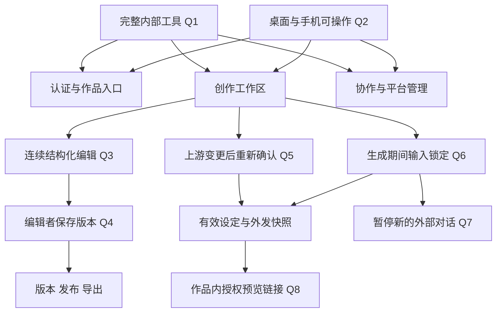

# 前端页面设计

2026-10-14 更新：模型管理、模型切换、对话输出、上下文与发送弹窗相关规则以[模型配置与创作对话设计](model-chat-design.md)及 [ADR-0011](adr/0011-direct-model-configuration-and-member-invocation.md) 为准；下文相关旧规则作为历史基线保留。新规则尚未实现。

日期：2026-10-13。状态：访谈 Q1-Q8 已确认；页面尺寸、组件库和具体技术参数为实施建议。本文描述待开发页面，不表示现有系统已具备浏览器界面。开发顺序和接口缺口见[前端开发方案](frontend-development-plan.md)，任务入口见[前端任务规格](../.scratch/frontend-experience/spec.md)。

## 1. 设计共识与边界

| 编号 | 已确认决策 | 页面与开发影响 |
| --- | --- | --- |
| Q1 | 完整内部工具设计，主创作流程优先分批开发 | 覆盖认证、作品、协作、创作、版本、正式稿、导出、回收站和管理页面 |
| Q2 | 桌面优先，手机可执行全部业务操作 | 桌面三栏、平板两区域、手机分视图；权限与能力不因设备减少 |
| Q3 | 连续剧本文档编辑，保留结构化剧本块 | 成熟编辑器承载写作，集/场景/片段导航，数据仍按 ADR-0006 保存 |
| Q4 | 编辑者可以显式保存版本 | 保存版本与发布正式稿分为不同操作；恢复、发布和导出仍仅所有者 |
| Q5 | 上游设定变更获批准后，下游重新确认 | 简报影响人物和大纲，人物影响大纲；历史内容保留，新的正文生成等待确认 |
| Q6 | 正文生成排队/运行期间锁定作品输入修改 | 全作品锁定正文、设定和参数写入，阅读、比较和取消仍可用 |
| Q7 | 正文生成期间暂停新的外部创作对话发送 | 保留未发送输入，历史对话可读，任务终态后恢复发送 |
| Q8 | 编辑者准备快照、所有者通过授权预览链接确认 | 异地协作无需共享设备；链接仍需登录和作品授权，不引入通知/审批中心 |

已有边界继续适用：账号由管理员创建；简体中文；作品默认私有；管理员没有隐含作品阅读权；每轮外部调用须有作品所有者对具体输入快照的外发确认；自动保存不创建版本；导出绑定正式稿发布记录。首版不增加公开注册、文件导入、跨片段重写和实时多人共同输入。

## 2. 信息架构与路由

登录后默认进入作品列表。普通用户导航为作品、邀请、回收站；账号菜单提供修改密码、退出。管理员额外显示管理入口，进入后以同级管理导航切换账号、模板、模型、审计和运维。管理页不能通过作品 ID 绕过成员授权。

| 页面 | 建议路由 | 入口与主要操作 |
| --- | --- | --- |
| 登录 | `/login` | 用户名、密码、登录；无注册按钮 |
| 首次/日常改密 | `/account/password` | 当前密码、新密码、确认新密码；首次改密前屏蔽业务路由 |
| 作品列表 | `/works` | 我的作品/参与作品筛选、搜索、最近更新排序、创建作品 |
| 新建作品 | `/works/new` | 选择模板、填写标题和模板参数，创建后进入工作区 |
| 待处理邀请 | `/invitations` | 作品标题、邀请者、角色、邀请时间、接受；只显示邀请所需元数据 |
| 创作工作区 | `/works/:workId` | 对话、设定/提案、正文/版本、任务状态 |
| 版本比较 | `/works/:workId/versions/compare?from=:id&to=:id` | 两个版本选择、结构化差异、只读预览、恢复入口 |
| 正式稿与导出 | `/works/:workId/releases` | 发布记录、当前正式稿、发布内容预览、格式选择、导出记录 |
| 成员管理 | `/works/:workId/members` | 成员、邀请、角色调整、撤销、所有权转移 |
| 作品参数 | `/works/:workId/settings` | 锁定模板版本、作品参数、删除至回收站；仅所有者修改 |
| 回收站 | `/trash` | 本人拥有的已删除作品、删除时间、恢复截止时间、恢复 |
| 管理员账号管理 | `/admin/users` | 创建、启停、重置密码、调整平台角色 |
| 管理员模板列表/编辑 | `/admin/templates`、`/admin/templates/:templateId` | 草稿定义、预览、版本、发布 |
| 管理员模型设置 | `/admin/models` | 供应商/模型配置两个视图，声明、启停、参数、凭证轮换 |
| 管理员审计记录 | `/admin/audit` | 时间、事件、操作者筛选，记录明细 |
| 管理员运维 | `/admin/operations` | 服务状态、备份记录、创建备份；恢复由受控运维流程执行 |
| 异常与不可访问 | 路由边界 | 会话失效、无权限、资源不存在、网络失败；提供返回作品列表 |

工作区的面板状态用查询参数保存，如 `panel=outline`、`view=versions`、`episode=2`，支持刷新和分享已获授权的页面定位；对话正文、临时指令、密钥和下载令牌不放入路由。邀请拒绝、模板停用和额外平台容量设置不是已有接口，实施前须另定契约，首版不展示无效按钮。

## 3. 视觉与响应式规范

- 整体为工作型工具：白色正文、浅灰导航和分隔线、深灰文字、绿色主操作、琥珀色待确认、红色错误；蓝色仅用于链接/信息。状态同时显示文字，避免只靠颜色表达。
- 系统中文字体；正文 16px/1.75，操作区 14px，页面标题 22px，面板标题 16px，次要状态 12px。字距为 0，不随视口宽度缩放字号。
- 使用 4/8/12/16/24px 间距；输入和列表项高 36-40px；触屏工具命中区域至少 44px。重复项与弹窗圆角 4-6px，页面区域用分隔线而非浮动卡片。
- 图标使用 Lucide。保存、撤销/重做、下载、导航收起等工具采用图标按钮和名称提示；生成、确认阶段、发布等业务命令保留清晰文字。
- 工作区全宽；其他页面内宽建议最多 1200px。表格桌面按列扫描，手机改成含相同字段的紧凑列表，不挤成横向长表。
- 封面不是必填业务数据；首版作品列表采用列表，不伪造剧照。视觉素材采用内置模板结构示例和由真实剧本内容形成的版式预览。
- 焦点可见，所有控件有名称，错误关联具体输入。抽屉/弹窗关闭后焦点回到入口；工具提示支持焦点触发，状态更新向辅助技术播报。

| 可用宽度 | 工作区布局 | 约束 |
| --- | --- | --- |
| >= 1280px | 对话 280px、设定 320px、正文剩余空间 | 正文至少 560px；布局不足时收起全局导航 |
| 768-1279px | 正文 + 一个辅助面板 | 对话/设定用分段控件切换，辅助面板可收起 |
| < 768px | 对话/设定/正文三个可切换视图 | 工具栏可换行；版本比较按差异项上下排列，审批/发布流程完整 |

面板可独立滚动，但页面标题和任务状态保持可见。手机使用动态视口高度与安全区域，输入框在软键盘出现后仍可触达；横向溢出只允许在版本比较的明确可滚动内容区域。

## 4. 页面细化

### 4.1 登录与改密

登录页直接提供表单和平台名称。密码有可访问的显示/隐藏按钮；提交中防止重复点击。错误区区分账号或密码错误、账号停用、登录过于频繁和服务不可达，不回显密码。

会话检查区分未登录、待改密、正常账号三种状态。首次改密页不能进入作品或管理页，但允许退出；刷新该页仍恢复待改密状态。改密成功后返回合法的内部目标路由或作品列表，禁止任意外部重定向。普通改密入口使用同一表单，提供取消。

首位管理员优先通过部署环境初始化，首版不提供公开的初始化管理员网页。忘记密码由管理员重置；页面不展示不存在的邮件找回流程。

### 4.2 作品列表与新建作品

作品列表显示标题、模板、本人作品角色、创作阶段、是否有活动生成任务、更新时间。默认最近更新在前；筛选切换不会清空搜索。整行标题可进入作品，所有者的更多菜单包含作品参数、成员管理、移入回收站；重命名须待对应接口完成。

空列表显示“暂无作品”及创建入口；搜索无结果提供清除筛选。列表查询失败保留已显示数据并提供重试；数据加载不能短暂把编辑者显示为所有者。删除确认展示作品标题和保留期限，不要求重复输入常规确认短语。

新建页面分为模板选择和参数填写两步，允许返回修改。模板用名称、结构示例、默认集数/目标展示，实际字段与范围以模板定义为准。参数包括标题、集数、单集时长或字数目标、题材标签、输出格式；未定义的字段不出现，已填值不因返回上一步无故丢失。没有可用模板时显示可联系管理员的状态。创建提交去重，成功后直接进入该作品。

### 4.3 创作工作区

桌面低保真结构：

```text
作品 / 标题   本人角色   阶段状态   自动保存状态   模型选择   成员   更多
--------------------------------------------------------------------------------
创作对话             | 设定 / 提案                | 正文 / 版本
对话记录             | 简报 人物 大纲             | 集/场景导航     当前正文
                     | 草稿或已确认内容           | 场景说明
                     | 阶段状态、确认入口         | 动作
                     | 提案前后内容               | 人物
                     |                            | 对白
                     |                            | 片段边界/选段工具
输入框、外发状态     | 保存/提交提案/审批          | 保存版本   生成   正式稿
--------------------------------------------------------------------------------
生成目标   排队/运行/失败/完成   发起者   开始时间   取消/查看结果
```

顶部展示整部作品阶段、本人角色、保存状态和当前模型。成员与参数跳转须处理未保存内容；返回工作区恢复原定位。正文内部目录可以收起，不额外强制增加第四列。

对话区显示作者、时间、用户消息和模型回复，未完成请求有明确状态且不伪造回复。输入支持多行，发送命令在中文输入法合成期间不触发。模型未配置或没有有效外发确认时保留输入内容，并给出对应状态。每轮实际外部发送前重新验证确认，不能通过一次授权永久发送后续内容。

设定区用简报/人物/大纲三个标签。草稿可并行准备，确认顺序依次推进。显示“未填写”“草稿”“已确认”“待重新确认”及待审批提案数量；是否可生成由当前有效确认决定，不由表单非空决定。

人物采用重复行或列表，姓名定位，详情在同级编辑区域展开；字段仍由该作品锁定模板定义产生。已确认内容默认只读，通过“提出变更”准备新内容。待重新确认的下游内容明确区分保留草稿和旧确认快照，所有者可检查保留内容后重新确认。

提案详情显示提交人、目标阶段、基础确认内容、拟变更内容和状态。所有者可批准/拒绝；批准前显示下游需要重新确认的影响。过期提案不能批准；同阶段已有待审批提案时进入现有提案详情。基线以不可变确认快照为准，编辑未生效草稿不应无故改变提案基础。

### 4.4 正文编辑与保存

正文为连续剧本文档。集、场景标题与正文共同呈现，片段边界低干扰显示；目录定位到集/场景/片段。块类型提供场景说明、动作、人物、对白；新增、类型切换、删除、撤销/重做均使用成熟编辑器事务，不手写光标和浏览器输入法逻辑。

保存明确区分：

| 命令/状态 | 结果 | 有权限的成员 |
| --- | --- | --- |
| 自动保存 | 更新工作草稿，不产生生成版本 | 所有者、编辑者 |
| 保存版本 | 对当前完整正文创建不可变生成版本 | 所有者、编辑者 |
| 发布正式稿 | 选定一个不可变版本创建发布记录 | 所有者 |
| 导出 | 从指定发布记录渲染 Markdown/DOCX | 所有者 |

建议输入停止 1 秒后自动保存，中文合成输入结束后才提交；具体时间可调整。顶部状态为未保存、保存中、已保存、保存失败、存在冲突。所有正文和设定修改共享作品写入协调，不能各面板用相同旧 revision 并行保存。

保存失败保留内存中的修改，重试须先验证服务器版本。冲突后停止自动覆盖，提供本地/服务器内容比较；用户选择保留哪部分后再提交。导航和关闭页签时如仍有未保存内容则提醒。登录失效后清除服务器缓存，不把正文写入持久化浏览器存储；当前未保存缓冲暂留内存并隐藏，仅同一账号重新认证后恢复，账号切换时清除。

### 4.5 外发确认与正文生成

生成面板选择目标集、场景或片段，填写指令和模型。选段重写只能在同一片段内选择连续文字；跨片段时无法提交并标出边界。片段重写与片段内选段重写分开表达，不能把后者实现为追加一段文字。

发起流程为：保存当前修改 -> 读取当前输入快照 -> 检查三阶段有效确认 -> 确认模型和目标 -> 所有者外发确认/验证已有确认 -> 创建幂等任务。外发弹窗展示供应商、模型及配置版本、实际数据类别、输入快照、目标与指令、数据保留/删除/故障处理说明，确认按钮为“确认外发并发送”或“确认外发并生成”。取消保留输入而不调用模型。

编辑者可在有效确认绑定的输入范围内调用；不能代所有者授权。无有效确认时显示“需要作品所有者确认”，提供“准备外发”命令，把实际消息/指令与资料范围明确提交为外发输入快照，再以图标按钮复制作品内授权预览链接。所有者在自己的设备登录并打开链接，检查快照有效性、权限和供应商声明后确认；编辑者返回准备结果可读取确认状态，按同一快照发起。首版不自动发送通知、不设独立审批中心；未经明确准备的临时输入不跨账号同步。

预览路由建议为 `/works/:workId?consent-preview=:snapshotId`；URL 只含作品与快照标识，不含原文。非成员打开时拒绝读取，链接自身没有授权作用。快照过期或作品输入变化时显示失效原因并要求重新准备，不能把旧链接自动切换到新内容并沿用确认。

正文任务创建成功后，全作品输入修改锁定。任务条展示目标、发起者和排队/运行/成功/失败/取消状态，不编造百分比。排队/运行时可取消；失败展示可操作原因，允许重试的任务显示重试，版本冲突/设定变化要求重新准备请求。成功显示结果版本并更新正文、版本列表和外发状态；旧确认不能继续复用。

锁定期间不能保存草稿、保存版本、恢复、改设定/参数、批准提案或发送新的外部创作对话。对话输入仍可准备且保留，历史对话可读。可阅读、比较、准备未生效提案、管理成员，所有者可发布/导出已有历史内容；移入回收站须收口活动任务。任务在刷新、换设备、关闭浏览器后仍由服务端推进。

### 4.6 版本、比较、正式稿与导出

版本列表显示时间、作者、来源（手动保存/生成/恢复）和正式稿标记。选择历史版本进入只读预览，不直接替换当前工作草稿。对比按集/场景/片段组织增加、删除、修改，桌面左右对照，手机逐项上下对照；相同内容可折叠，保留剧本语义格式。

恢复入口仅所有者可见；确认区显示来源版本、当前未保存/草稿状态、恢复会产生新版本。恢复前解决本地未保存内容并检查没有活动生成任务。恢复结果进入新版本，旧版本和正式稿仍保留。

正式稿页列出发布记录、关联版本、发布人、发布时间和当前标记。发布先选择并预览不可变版本；存在更新草稿时直接说明本次发布不包含它。导出先选发布记录，再选 Markdown/DOCX。查看者和编辑者可阅读正式稿，不能导出。

导出状态包含准备中、成功、失败和下载已过期，成功后提供下载命令和到期时间。刷新页面或链接过期可申请新下载链接，失败可重新导出同一发布记录；下载令牌不进入日志、浏览器持久存储或普通分享 URL。实际任务状态与服务端一致，不为同步完成的导出伪造等待动画。

### 4.7 邀请、成员、参数与回收站

邀请页在接受前只提供最小元数据，不获取创作对话、正文或设定；接受后才跳转工作区。成员页显示用户名、角色、邀请状态和时间，所有者按用户名邀请，不要求普通用户读取全平台账号列表。邀请重复/撤销后再次邀请按服务端结果刷新。

所有权转移只能选择已接受且启用的成员；确认显示接收人及原所有者将变为编辑者。成功后重新读取权限，立即移除原所有者的确认、发布、导出和成员管理操作。

参数页展示锁定模板及版本，允许修改模板范围内参数，不自动升级模板版本。变更使外发确认失效。正文生成期间参数只读。作品重命名需新增接口后开放，模板迁移不属于首版。

回收站仅列本人拥有的作品。恢复成功后回到作品列表，旧外发确认及下载链接不会复活；协作者不能通过原链接访问已删除作品。首版常规页面提供恢复，超过 30 天由服务端清理；不添加尚未实现的任意提前永久删除入口。

### 4.8 管理页面

账号页以表格/移动列表呈现用户名、平台角色、启停状态、首次改密状态、创建时间。创建与重置密码时设置临时密码，不把密码写入列表、日志或 URL。停用前如需转移作品，显示业务限制；管理员不能获得作品正文以协助转移，先由该作品所有者处理。

模板页以版本列表和结构化定义编辑为主，字段控件支持名称、中文标签、类型、范围、必填、默认值、顺序及嵌套项，侧边预览实际新建作品/创作表单。发布前验证定义；更新已发布模板形成新草稿，不修改旧作品快照。

模型页分为供应商与模型配置：供应商包括适配类型、启停、三类数据处理说明；配置包括模型标识、端点、参数和版本。凭证输入为空代表保持原值，轮换后创建新配置版本；界面只展示是否已配置，永不回填原密钥。启用不完整声明的供应商时定位缺失字段。

审计页按时间、事件和操作者筛选，明细只展示允许的元数据。运维页展示服务与备份元数据，创建备份前确认；备份恢复影响整个系统，使用经过验证的运维流程及审计，不把当前快照写回接口当作完整恢复按钮。

## 5. 角色矩阵

管理员按实际作品成员角色使用下表，平台管理员身份不增加作品能力。

| 作品操作 | 所有者 | 编辑者 | 查看者 |
| --- | --- | --- | --- |
| 读取全部创作资料、历史版本和正式稿 | 是 | 是 | 是 |
| 编辑草稿、保存版本、准备/提交变更提案 | 是 | 是 | 否 |
| 创作对话/正文生成（有效外发确认内） | 是 | 是 | 否 |
| 确认外发、确认阶段、批准/拒绝提案 | 是 | 否 | 否 |
| 恢复版本、发布正式稿、导出 | 是 | 否 | 否 |
| 修改参数、管理成员、转移、删除和恢复作品 | 是 | 否 | 否 |

生成锁定额外限制所有成员的输入修改。权限变化以服务端能力和 API 拒绝为准，不能只靠隐藏按钮。

## 6. 状态与验收示例

| 场景 | 预期页面行为 |
| --- | --- |
| 首次改密页刷新 | 仍显示改密流程，不循环跳转登录/作品 |
| 管理员打开未获授权作品链接 | 显示不可访问，不请求或显示创作资料 |
| 两个编辑者同时保存 | 后提交者进入冲突处理，服务器已有内容不被覆盖 |
| 批准新人物设定 | 大纲显示待重新确认，历史正文可读，新的正文生成被阻止 |
| 生成排队后另一成员编辑参数 | 界面只读，直接 API 修改也被拒绝 |
| 手机选段跨片段 | 无法提交重写，选区原文仍保留 |
| 发布后继续编辑草稿再导出 | 下载对应发布版本，未发布修改不进入文件 |
| 导出后刷新页面 | 可获取新短链接并下载同一发布内容 |
| 账号停用或成员撤销 | 下一次认证/查询失败后清除页面数据，不继续显示缓存正文 |
| 浏览器离线 | 保留未保存缓冲，停止提交与轮询，不误报已保存 |

## 7. 决策树与工程建议



八项产品选择均已由用户确认。实现建议为 React/TypeScript/Vite、同源 Web/API、成熟编辑器、轮询任务状态、乐观并发保存；它们沿用现有开发设计和 API 约束，具体版本与参数在实施前评审。后续如增加独立外发审批箱、实时共同输入或网页内全系统恢复，需另开设计分支，不能作为已确认范围直接加入。
